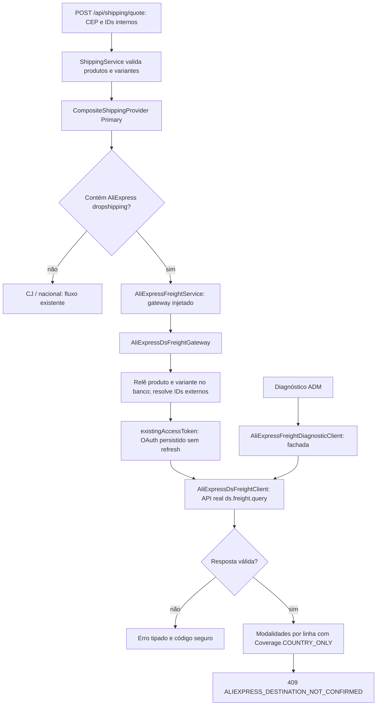

# Checkout ligado ao gateway real, com proteção comercial — 21/10/2026

## Resultado

Foi removida a desconexão técnica identificada em `ALIEXPRESS-CHECKOUT-WIRING-409.md`: o serviço recebe um gateway concreto por construtor e chama efetivamente a API compartilhada. Não existe mais construtor padrão que instala lambda bloqueadora nem bypass de `gateway.calculate()`.

**Isso não libera compra AliExpress.** Uma resposta válida de `ds.freight.query` é uma observação por país; continua sem validação suficiente para pedido/endereço. Depois da chamada bem-sucedida, o checkout retorna HTTP 409 com `fields.code=ALIEXPRESS_DESTINATION_NOT_CONFIRMED`. Não há flag ou ramo capaz de transformar essa observação em opção comercial confirmada nesta entrega.

O antigo bloqueio de pagamento `requireConfirmedFreight` permanece intacto, inclusive para pedidos antigos. Não foram implementadas persistência definitiva de cotação, conversão cambial, consolidação de remessas ou liberação de checkout. Não houve alteração de importação, credenciais, pedidos/pagamentos reais, commit, push ou deploy.

## Fluxo após a correção

Em carrinho misto com AliExpress, continuam não sendo consultados os provedores nacional/CJ para fabricar uma alternativa. Os produtos não AliExpress são identificados pelo cadastro e não são enviados à API AliExpress. Não há soma de fretes individuais fingindo consolidação.

## Arquivos de produção

- `integration/aliexpress/AliExpressDsFreightClient.java`: implementação compartilhada extraída do cliente ADMIN. Mantém protocolo, assinatura, timeouts, ausência de retries/redirects, parser e sanitização existentes. Centavos ambíguos continuam rejeitados. Código de modalidade inválido passa a ter classificação própria.
- `integration/aliexpress/AliExpressFreightDiagnosticClient.java`: fachada compatível do ADM, delegando ao mesmo bean compartilhado. Os testes existentes de transporte/parser continuam exercitando a implementação real por essa fachada.
- `integration/aliexpress/AliExpressDsFreightGateway.java`: novo `@Component` concreto. Resolve IDs locais no banco, valida relação produto/variante/fornecedor, status, quantidade e estoque; consulta OAuth persistido e cada linha AliExpress; devolve observações separadas por linha.
- `integration/aliexpress/AliExpressFreightGateway.java`: fronteira **interna** passa a receber `ShippingProvider.Request` com IDs locais e devolver `Evaluation`/`LineQuote` com cobertura explícita `COUNTRY_ONLY`. O contrato HTTP público não mudou.
- `integration/aliexpress/AliExpressFreightService.java`: construtor único com gateway injetado; `quote()` chama e verifica a avaliação antes de aplicar o bloqueio comercial. Removidos clock/construtor alternativo/candidato não utilizado pelo checkout. A proteção estática de pagamento permanece.
- `integration/aliexpress/AliExpressShippingException.java` e `shared/exception/GlobalExceptionHandler.java`: mensagens locais, categorias distintas e `fields.code` seguro. Nenhum corpo, causa, token ou texto bruto do fornecedor é retornado.
- `frontend/lib/admin/aliexpress-freight.ts`: apenas inclusão do novo código seguro `INVALID_DELIVERY_METHOD` na lista aceita pelo ADM.

`ShippingService`, `CompositeShippingProvider`, providers CJ/nacional, DTOs públicos de frete e classes de importação/pagamento não foram alterados. O fluxo de sucesso CJ/nacional permanece igual. Respostas de erro mantêm o envelope `ApiError` existente, adicionando um código em `fields`.

## IDs e dados enviados

O gateway ignora IDs externos e preços presentes como sugestões em `ShippingProvider.Item`, mesmo que a chamada seja feita internamente. Relê `Product` e `ProductVariant` usando IDs locais e exige que a variante pertença ao produto e ao fornecedor AliExpress e que os dois cadastros concordem no ID externo do produto. SKU externo fica String, sem conversão para Number JavaScript.

Todas as linhas são validadas antes da primeira chamada OAuth/HTTP. Quantidades repetidas da mesma variante são agregadas e validadas, com limite local 1–100 por linha AliExpress e estoque suficiente. Não há reserva de estoque ou alteração de cadastro. Falha de uma linha impede o uso de resultado parcial como frete comercial.

O [contrato oficial de ds.freight.query](https://openservice.aliexpress.com/handler/share/apidoc/getApi?cid=21038&path=aliexpress.ds.freight.query&methodType=GET%2FPOST), docId 1579, foi conferido por leitura pública em 21/10/2026 (`target/checkout-connected-contract.json`). O adaptador utiliza os mesmos sete campos obrigatórios do ADM: produto externo, SKU, quantidade, `shipToCountry=BR`, `currency=BRL`, `language=pt_BR`, `locale=pt_BR`.

CEP é validado apenas no contrato local e **não enviado** ao fornecedor. Não há rua, número ou dados pessoais no DTO da API. Campos opcionais `province`/`provinceCode`/`cityCode` não são inventados a partir de UF/IBGE. Nenhuma origem é presumida; ela é retornada por modalidade. Uma consulta por país não adquire cobertura por endereço por estar sendo chamada pelo checkout.

Transporte: gateway único `https://api-sg.aliexpress.com/sync`, protocolo TOP, token em `session`, HMAC-SHA256, parâmetros ordenados, timestamp epoch, POST form UTF-8 e `simplify=true`. Nenhuma credencial foi modificada e não há refresh nem fallback de host/provedor. A descrição/exemplo oficial de `shipping_fee_cent` continua conflitante; a rejeição `AMBIGUOUS_MONETARY_UNIT` não foi contornada. Valores normalizados ficam em BigDecimal, com moeda original; não há câmbio nem frete zero/fixo presumido.

## Erros observáveis no endpoint

| Código em `fields.code` | HTTP | Significado |
| --- | --- | --- |
| `ALIEXPRESS_PERMISSION_DENIED` | 409 | Acesso à operação explicitamente negado |
| `ALIEXPRESS_AUTHENTICATION_FAILED` | 409 | Token local indisponível/ilegível/expirado ou token rejeitado; não significa sessão do cliente expirada |
| `ALIEXPRESS_INVALID_PARAMETERS` | 409 | IDs, vínculo da variante, quantidade ou parâmetros rejeitados |
| `ALIEXPRESS_FREIGHT_UNAVAILABLE` | 409 | Estoque não comprovado, frete indisponível ou ausência de modalidades |
| `ALIEXPRESS_INVALID_DELIVERY_METHOD` | 409 | Código de modalidade do fornecedor inválido |
| `ALIEXPRESS_AMBIGUOUS_MONEY` | 409 | Unidade monetária ou flag de frete grátis conflitante |
| `ALIEXPRESS_INVALID_RESPONSE` | 502 | Resposta incompleta/inconsistente |
| `ALIEXPRESS_EXTERNAL_FAILURE` | 502 | Comunicação ou rejeição externa sem classificação comercial segura |
| `ALIEXPRESS_NOT_CONFIGURED` | 503 | Configuração local ausente |
| `ALIEXPRESS_RATE_LIMITED` | 429 | Limite do fornecedor |
| `ALIEXPRESS_DESTINATION_NOT_CONFIRMED` | 409 | API consultada e modalidades normalizadas, mas somente por país; compra ainda bloqueada |

Modalidade comercial arbitrária fornecida pelo cliente continua não sendo aceita. `ShippingService.select()` não obtém opção AliExpress antes de resolver a cobertura comercial, portanto código forjado não permite criar pedido. As proteções de pagamento são independentes desse caminho.

## Testes e ausência de efeitos financeiros

- Spring completo comprova que o `ShippingService` utiliza o composite primário e que existe exatamente um bean concreto AliExpress.
- Contexto Spring comprova construtor único, chamada real ao gateway configurado e compartilhamento da mesma instância do cliente entre fachada ADM e adaptador.
- POST real de checkout em MockMvc percorre service/composite/gateway reais, com HTTP externo simulado; verifica IDs vindos do banco, ignora campos externos/preços forjados e não altera contagens de pedidos/pagamentos.
- Adaptador com transporte real e `MockRestServiceServer` verifica `/sync`, método, produto/SKU reais do cadastro, campos documentados e ausência de CEP/IDs forjados no payload; valida valor exato e cobertura somente por país.
- Casos negativos cobrem variante de outro produto, referência externa divergente, OAuth indisponível sem refresh, permissão, indisponibilidade, parâmetros, comunicação, modalidade inválida e moeda ambígua. Linhas duplicadas não causam consulta separada com quantidade errada.
- Casos CJ/nacional, diagnóstico ADM, invalidação do candidato interno e proteções de pagamento permanecem na regressão. Os antigos testes que caracterizavam a desconexão foram substituídos por testes positivos de ligação técnica; a proteção comercial continua sendo testada negativamente.

Arquivos de teste alterados/adicionados:

- `src/test/java/com/garage/garageapi/integration/aliexpress/AliExpressDsFreightGatewayTests.java`.
- `src/test/java/com/garage/garageapi/integration/aliexpress/AliExpressFreightWiringTests.java`.
- `src/test/java/com/garage/garageapi/integration/aliexpress/AliExpressFreightQuoteTests.java`.
- `src/test/java/com/garage/garageapi/integration/aliexpress/AliExpressCheckoutRecipientIntegrationTests.java`.
- `src/test/java/com/garage/garageapi/shipping/ShippingIntegrationTests.java`.

Validação final: **570 testes backend em 64 classes**, zero falhas/erros/ignorados, Maven exit 0 (`target/checkout-connected-final.log`); **42 testes frontend** aprovados, `tsc --noEmit`, ESLint do arquivo frontend alterado e `git diff --check` aprovados. Um teste legado que esperava a antiga mensagem genérica foi atualizado para verificar o código específico de indisponibilidade, mantendo a asserção de ausência de pedido/pagamento.

Os novos testes de cotação não criam pedidos ou cobranças. Testes legados da suíte usam fixtures em H2 e provedores simulados; não há ordens ou pagamentos reais.

## O que pode ser testado após publicação manual

Com um produto AliExpress ativo, variante vinculada e estoque cadastrado, uma conta autenticada pode chamar `/api/shipping/quote` pelo checkout normal, com IDs **locais**, quantidade e CEP. A consulta passará pelo gateway real e pelo OAuth persistido. O diagnóstico ADM também permanece disponível.

Um retorno `ALIEXPRESS_DESTINATION_NOT_CONFIRMED` comprova que esse caminho obteve modalidades normalizáveis, sem constituir frete confirmado. Falha de permissão/autenticação/parâmetros/unidade pode ser distinguida pelo código. A aplicação não armazena a cotação como definitiva e não oferece o valor como opção pagável. O frontend atual pode continuar mostrando mensagem genérica de indisponibilidade; o código específico está na resposta do endpoint.

Ainda impedem liberar pagamentos: ausência de evidência autenticada BR comprovada nesta tarefa, unidade monetária efetiva, cobertura/mapeamento territorial do endereço, revalidação comercial por pedido e snapshot/persistência/idempotência de cotação. Essa etapa futura também deverá validar modalidade por linha/remessa no envio manual ao fornecedor. Nada disso é autorizado por sucesso da chamada técnica por país.
