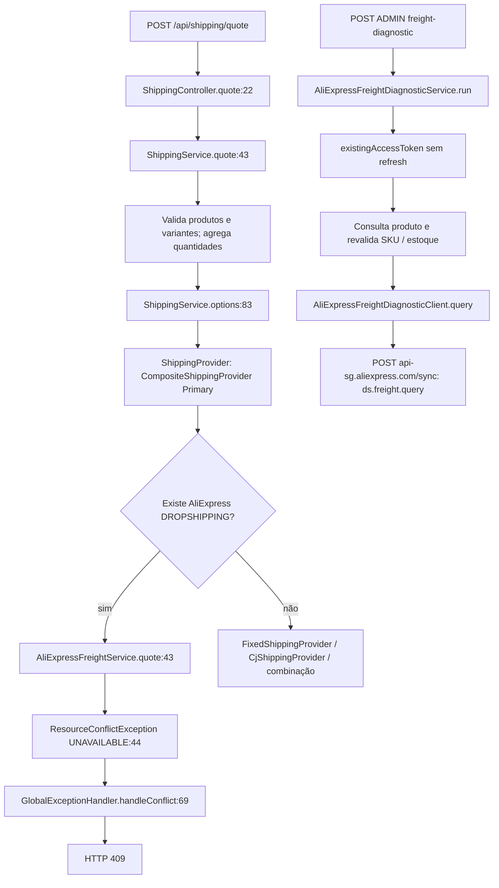

# Checkout AliExpress: causa do HTTP 409 e proposta mínima — 21/10/2026

## 1. Causa raiz comprovada

Atualização posterior em 21/10/2026: a desconexão descrita abaixo foi corrigida. O serviço injeta o gateway concreto e consulta o cliente compartilhado; o bloqueio por cobertura comercial insuficiente permanece. Veja [o fluxo corrigido e os códigos novos](ALIEXPRESS-CHECKOUT-CONNECTED.md). Este relatório preserva a auditoria anterior.

O código auditado bloqueia o checkout deliberadamente, antes de chamar qualquer gateway externo. Não se trata de uma rejeição retornada pela API AliExpress neste caminho. A mensagem de produção informada coincide literalmente com a constante local; a revisão efetivamente publicada no Railway não foi inspecionada nesta tarefa.

| Evidência | Arquivo / método / linha |
| --- | --- |
| Mensagem literal `O frete dos produtos AliExpress ainda não pode ser confirmado. A compra está temporariamente indisponível para esses itens.` | `src/main/java/com/garage/garageapi/integration/aliexpress/AliExpressFreightService.java:19` (`UNAVAILABLE`) |
| Exceção incondicional, sem ler a requisição e sem chamar `gateway` | Mesmo arquivo, `quote(ShippingProvider.Request)`, linha 44 |
| Condição que encaminha para o bloqueio: algum item tem `supplier=ALIEXPRESS` (case insensitive) **e** `fulfillmentType=DROPSHIPPING` | `src/main/java/com/garage/garageapi/shipping/provider/CompositeShippingProvider.java:28`; chamada na linha 30 |
| Conversão de `ResourceConflictException` para HTTP 409 com a mesma mensagem | `src/main/java/com/garage/garageapi/shared/exception/GlobalExceptionHandler.java:69`, `handleConflict`; resposta na linha 72 |

Produto/variante, atividade e disponibilidade são validados antes desse encaminhamento em `ShippingService.quote`. Uma requisição pode falhar antes por outros motivos, mas, ao atingir a condição AliExpress acima, `quote` sempre lança esse bloqueio. Carrinhos mistos também são bloqueados antes de consultar CJ ou frete nacional.

Há uma **segunda desconexão**: o construtor público sem argumentos de `AliExpressFreightService` (linha 23) instala uma lambda `AliExpressFreightGateway` que apenas lança a mesma exceção (linha 24). O construtor alternativo (linha 27) não tem `@Autowired` e é utilizado diretamente pelos testes. O método interno `candidate` (linha 34) usa `gateway.calculate` (linha 36), mas não é chamado pelo método público `quote`.

Portanto, apenas registrar um gateway ou trocar uma variável de ambiente não resolve: é necessário corrigir tanto a injeção quanto o caminho público de cotação.

## 2. Fluxograma real

Não há implementação concreta de `AliExpressFreightGateway` a alcançar pelo endpoint: a chamada termina no bloqueio. A lambda interna também não é alcançada por esse caminho; somente `candidate` a utiliza. O ADM possui um caminho separado para o cliente real.

### Injeção Spring e configuração

- `GarageApiApplication:6`: `@SpringBootApplication` faz o scan de `com.garage.garageapi`.
- `ShippingController:17`: construtor recebe `ShippingService`; `quote` encaminha a chamada na linha 23.
- `ShippingService:27`: `@Service`; seu construtor na linha 35 recebe `ShippingProvider`. O campo é preenchido na linha 37.
- `CompositeShippingProvider:11`: `@Primary` e `@Component`; vence a escolha de `ShippingProvider` sobre `FixedShippingProvider`, também `@Component`. Recebe `AliExpressFreightService` por construtor na linha 18.
- `CjShippingProvider` é um `@Component` separado; o composite o chama explicitamente, não é o bean injetado diretamente como `ShippingProvider`.
- `AliExpressFreightService:16`: `@Service`, construtor público sem argumentos; não há `@Bean` de gateway em produção, classe `implements AliExpressFreightGateway`, `@Profile` ou configuração condicional que o substitua no repositório.
- `AliExpressFreightDiagnosticClient:23`: `@Component`, utilizado em produção apenas por `AliExpressFreightDiagnosticService` (construtor linha 13; chamada linha 59). Este serviço é alcançado por `AliExpressDiagnosticsController:26`, protegido por `hasRole('ADMIN')` na linha 10.
- `application.properties:52`: configura credenciais/OAuth. As flags `aliexpress.orders.enabled` e `aliexpress.orders.contract-confirmed` das linhas 56/57 controlam pedidos; não selecionam gateway de frete nem alteram o `throw` do checkout. Não existe flag de frete capaz de conectar esse caminho hoje.

Logo, o 409 ocorre antes de leitura/refresh de OAuth, consulta de produto externo ou chamada de `ds.freight.query`. O teste HTTP confirma ausência de interações com cliente AliExpress, tokens e integrações CJ. Não foram lidos valores de credenciais ou alteradas configurações.

## 3. Cliente real versus contrato interno

Os contratos públicos de frete (docId 1579) e pedido (docId 479) foram conferidos novamente em 21/10/2026, por leitura pública sem credenciais. Os snapshots estão em `target/checkout-wiring-*.json`. Referências:

- [aliexpress.ds.freight.query](https://openservice.aliexpress.com/handler/share/apidoc/getApi?cid=21038&path=aliexpress.ds.freight.query&methodType=GET%2FPOST).
- [aliexpress.trade.buy.placeorder](https://openservice.aliexpress.com/handler/share/apidoc/getApi?cid=21038&path=aliexpress.trade.buy.placeorder&methodType=GET%2FPOST).

| Aspecto | Checkout hoje | Cliente ADMIN / contrato AliExpress | Mudança necessária |
| --- | --- | --- | --- |
| Transporte | Nenhum gateway real chamado | TOP `/sync`, `session`, HMAC-SHA256, timestamp epoch, `queryDeliveryReq` | Extrair/reutilizar cliente comum; sem duplicar credenciais ou transportes |
| Produto | `ShippingProvider.Item.productId` é ID local; não contém ID externo do produto | `productId` externo String | Resolver no backend usando produto/variante confiáveis |
| Variante | Item contém ID local e `supplierVariantId` | `selectedSkuId` externo String | Validar vínculo e snapshot; nunca converter SKU para Number JavaScript |
| Quantidade | Linha do candidato permite até 1000 | Diagnóstico limita 1–100 | Harmonizar limites, sem fragmentar quantidade arbitrariamente |
| País | Request público só tem CEP; candidato interno exige `BR` | `shipToCountry` obrigatório, cliente envia BR | Definir BR explicitamente a partir da regra/endereço confiável |
| Estado/cidade | Candidato tem UF e nome de cidade; request público não os transporta | `province` ou `provinceCode` (não ambos), `cityCode`, opcionais; província descrita para local-to-local | Validar códigos do fornecedor; UF/IBGE/nome da cidade não são automaticamente códigos AliExpress |
| Origem | `AliExpressFreightQuote.Line` exige origem antes de cotar | API não exige origem na entrada; devolve `ship_from_country` por opção | Ajustar modelo interno para origem da resposta; não inferir CN nem usar país da loja |
| Destino completo | `AliExpressFreightQuote.Destination` tem CEP, UF, cidade, rua, número, bairro e complemento | API de frete não documenta CEP, rua, número, bairro, complemento ou destinatário | Vincular endereço internamente sem enviá-lo em campos inventados; não transformar consulta por país em frete definitivo |
| Moeda/valor | `Method` interno exige BRL, duas casas e limite de magnitude | Cliente preserva moeda retornada e normaliza centavos inequívocos com BigDecimal | Rejeitar moeda não BRL no checkout até política cambial válida, sem conversão presumida |
| Modalidade | Candidato usa `serviceName`; resposta pública tem código/nome e remessas | Cliente coloca `delivery_options[].code` em `serviceName`, `company` é nome visual | Preservar código bruto por linha/remessa, sem trocar por nome de exibição |
| Validade | Candidato interno compara contexto e aplica 10 minutos locais; não é persistido | Retorno inspecionado não garante preço/reserva durante esse período | Persistir contexto, proprietário e validade local; reconsultar/rejeitar alterações antes de confirmar pedido/cobrança |

O transporte real está em `AliExpressFreightDiagnosticClient.query:42`; o envelope de negócio é montado nas linhas 52–60. A fronteira interna `AliExpressFreightGateway.calculate` recebe um `AliExpressFreightQuote.Context` e devolve somente métodos, não o resultado diagnóstico com status/códigos/limitações. Não se deve simplesmente fazer cast ou substituir o serviço pelo cliente ADMIN.

### Valores e modalidades: há ambiguidade conhecida

O esquema declara `shipping_fee_cent` em centavos, mas o exemplo oficial continua com `"1.99"` junto de `shipping_fee_format="US $1.99"`. Não há base para normalizar todo retorno sem ambiguidade. O cliente rejeita esse caso com `AMBIGUOUS_MONETARY_UNIT`; aceita apenas centavos inteiros inequívocos, rejeita conflito com formato simples reconhecível e com `free_shipping`, preserva moeda e usa strings decimais no frontend. Essa validação precisa ser preservada no adaptador, não contornada para eliminar o 409.

O retorno `delivery_options[].code` é descrito como código utilizável para criar pedido; `company` é nome visual. O contrato de pedido usa `product_items[].logistics_service_name` e `sku_attr`. Já `AliExpressOrderPreparation:68` envia `shippingLeg.name()`: será necessário garantir que seja enviado o **código bruto confirmado**, ligado à linha/remessa, e não a empresa. A preparação atual aceita somente uma remessa (linha 37), incompatível com a suposição de que produtos/origens distintos sempre compartilham um envio.

Separadamente, a preparação ainda envia `birth_date` no endereço (linha 79), enquanto o contrato atual documenta `ds_extend_request.trade_extra_param.birthday` para BR. Isso deve ser corrigido/testado antes de habilitar criação de pedidos; nenhuma compra foi feita para testar o contrato.

### Prova de cotação autenticada BR

Não foi encontrada prova no repositório nem fornecido resultado autenticado nesta tarefa. `ALIEXPRESS-DS-FREIGHT-DIAGNOSTIC-EVIDENCE.json:240` registra permissão não comprovada e a linha 241 registra `authenticatedQueryPerformed=false`. Isso descreve a evidência disponível, não demonstra que nenhuma chamada ocorreu fora desta sessão. OAuth funcional ou testes simulados não comprovam grants, cotação real ou cobertura por endereço. Nenhuma consulta autenticada de produção foi executada aqui.

## 4. Alterações mínimas recomendadas — proposta, não implementadas nesta entrega

1. Extrair o transporte/parsing para um cliente compartilhado, reutilizando o comportamento validado de `AliExpressFreightDiagnosticClient`, inclusive códigos seguros e rejeição monetária. ADM e adaptador passam a consumi-lo; OAuth continua no backend, persistido, sem renovação durante a validação.
2. Criar um adaptador Spring `AliExpressFreightGateway` e tornar explícita sua injeção no serviço, eliminando a seleção silenciosa do construtor bloqueador. Corrigir também `quote`: só trocar o bean **não** basta. Testar a chamada completa com Spring real e HTTP do fornecedor simulado.
3. Manter `/api/shipping/quote`, a estrutura existente de opções e o comportamento CJ/nacional. Adicionar contexto de endereço/identidade de forma compatível — por exemplo, `addressId` opcional adicional no DTO, exigido no ramo AliExpress autenticado — resolvendo propriedade/snapshot no backend. A requisição atual com apenas CEP é insuficiente para validar o endereço completo. Não exigir mudança dos clientes locais/CJ nem aceitar preços do navegador.
4. Adaptar o modelo interno para origem retornada, limites/precisão compatíveis, códigos e opções por linha/remessa. Não somar opções de produtos distintos como envio consolidado sem contrato que sustente essa operação. Carrinhos mistos continuam com tratamento separado por provedor.
5. Persistir e validar cotação, contexto completo, proprietário, escolhas por remessa, validade, moeda/total e idempotência. Recalcular ao mudar carrinho/endereço e rejeitar preços divergentes antes de criar pedido ou cobrar. Consulta por país continua diagnóstica se a cobertura do destino não for comprovada.
6. Manter `requireConfirmedFreight` protegendo pagamento (`PaymentAttemptService:43` e `:67`) até existir evidência suficientemente vinculada ao pedido. O bloqueio atual é incondicional para AliExpress não local: ligar o adaptador não pode implicar removê-lo. Na etapa posterior, substituir por verificação de prova persistida, não por uma flag ou simples presença de modalidade. Preservar envio administrativo posterior ao pagamento do cliente e pagamento manual ao fornecedor.

A importação não precisa ser alterada e não foi tocada.

## 5. Testes e fronteira da comprovação

- Adicionado teste no contexto completo Spring que verifica que `ShippingService` recebe o `CompositeShippingProvider` primário e que não há bean `AliExpressFreightGateway`.
- Reforçado o teste HTTP AliExpress/misto para verificar que o 409 não interage com cliente AliExpress, tokens ou integrações CJ, inclusive com mudanças de CEP/quantidade.
- Adicionados testes com contexto Spring mínimo que provam que registrar um bean de gateway/Clock não substitui o construtor padrão e que `quote` ignora até um gateway explicitamente passado ao construtor alternativo.
- Ampliada a invalidação do candidato interno para troca de SKU, inclusão de item, origem, cidade/UF e complemento, mesmo mantendo CEP. Essa é proteção unitária de um candidato; não é cotação persistida de checkout já implementada.
- Reexecutados os testes existentes de cliente real com HTTP simulado: normalização exata, moeda/códigos, permissão, indisponibilidade, ambiguidades; e regressões de bloqueio de pedidos/pagamentos.
- O teste positivo **“checkout chama o cliente quando configurado” permanece pendente da implementação do adaptador e do caminho público**. Atualmente não há tal configuração. Não foi criado um mock de `ShippingProvider` para apresentar esse caminho inexistente como funcional. Os testes negativos acima identificam exatamente o que o teste positivo deve substituir após a correção.

Validação executada: **136 testes em 10 classes**, zero falhas, erros ou ignorados; Maven exit 0 (`target/checkout-wiring-tests.log`). `git diff --check` aprovado. Os quatro casos novos cobrem a escolha Spring, duas formas de injeção inefetiva e invalidações adicionais do candidato. Contextos de teste usam H2 e fronteiras externas simuladas; não representam evidência de cotação autenticada.

Nenhum código de produção, contrato público, credencial, importação ou configuração foi alterado; apenas testes e este relatório. Sem commit, push ou deploy. Sem pedidos ou pagamentos reais.
